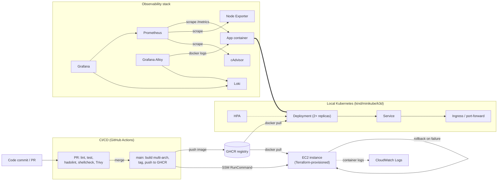

# DevOps Engineer Assessment — Hello from DevOps Task

Live deployment: https://app-kappa-azure.vercel.app/

A small Node.js/Express web service taken from source to a containerized,
CI/CD-deployed, Kubernetes-orchestrated, fully observed production-style
setup, as specified in the assessment brief.

## Contents

- [Architecture](#architecture)
- [Prerequisites](#prerequisites)
- [Running locally](#running-locally)
- [Running the observability stack](#running-the-observability-stack)
- [Running the tests](#running-the-tests)
- [Terraform](#terraform)
- [Kubernetes](#kubernetes)
- [system_health.sh](#system_healthsh)
- [Design decisions](#design-decisions)
- [Deployment & rollback strategy](#deployment--rollback-strategy)
- [Security considerations](#security-considerations)
- [Monthly AWS cost estimate](#monthly-aws-cost-estimate)
- [Investigating an error spike](#investigating-an-error-spike)
- [What I would improve with more time](#what-i-would-improve-with-more-time)

## Architecture



- **Code Commit → CI → Registry → EC2**: every PR is linted, tested, and
  scanned; every merge to `main` builds a multi-arch image, pushes it to
  GHCR, and deploys it to the EC2 instance over SSM with an automatic
  smoke-test/rollback.
- **Kubernetes flow**: the same image runs as a 2-replica Deployment behind
  a Service/Ingress with an HPA, demoed locally on kind/minikube/k3d.
- **Observability flow**: Prometheus scrapes the app, the host
  (Node Exporter) and containers (cAdvisor); Grafana Alloy tails container
  logs into Loki; Grafana visualizes both, provisioned entirely from files
  in this repo.

## Prerequisites

- Node.js 20+ (only needed for running the app outside Docker)
- Docker Engine + Docker Compose v2
- `kubectl` and one of `kind` / `minikube` / `k3d` for Step 4
- Terraform >= 1.6 and AWS credentials for Step 3 (optional — see below)

## Running locally

```bash
docker compose up --build
# port 8080 already taken on your machine (e.g. by another project)?
# APP_HOST_PORT=8090 docker compose up --build
```

- App: http://localhost:8080/ (or your `APP_HOST_PORT`)
- Health: http://localhost:8080/health
- Metrics: http://localhost:8080/metrics

Verified live (`docker compose up --build`, then curled each endpoint):

```
$ curl -s localhost:8080/
{"message":"Hello from DevOps Task!","status":"running","version":"1.0.0"}
$ curl -s localhost:8080/health
{"status":"ok","environment":"local","version":"1.0.0"}
$ docker images devops-task-app:local --format "{{.Repository}}: {{.Size}}"
devops-task-app: 204MB
```

## Running the observability stack

```bash
cp .env.monitoring.example .env.monitoring   # edit GRAFANA_ADMIN_PASSWORD
docker compose -f docker-compose.yml -f docker-compose.monitoring.yml \
  --env-file .env.monitoring up --build -d
```

- Grafana: http://localhost:3000 (user/password from `.env.monitoring`) —
  the **Application**, **Host**, and **Containers** dashboards are
  provisioned automatically under the "DevOps Task" folder.
- Prometheus, Loki, Alloy, Node Exporter, and cAdvisor are **not** published
  to the host — only reachable from Grafana over the internal `obs-net`
  network.
- Generate some traffic first so the Application dashboard has data:
  `for i in {1..50}; do curl -s localhost:8080/ > /dev/null; done`

## Running the tests

```bash
cd app
npm ci
npm test        # unit tests + coverage (app/coverage/lcov-report/index.html)
npm run lint     # eslint
```

## Terraform

Verified without AWS credentials (no account was available in the build
environment): both modules pass `terraform fmt -check`, `terraform init
-backend=false`, and `terraform validate`:

```
$ terraform validate
Success! The configuration is valid.
```

`terraform plan`/`apply` need real AWS credentials (the config reads the
default VPC, creates IAM roles, etc.) and will provision billable
resources — run them yourself with your own AWS account:

```bash
cd terraform/bootstrap
terraform init
terraform apply -var state_bucket_name=<your-unique-bucket-name>
# note the bucket + dynamodb table names from the output, then:

cd ../
terraform init \
  -backend-config="bucket=<bucket>" \
  -backend-config="key=devops-task/staging/terraform.tfstate" \
  -backend-config="region=us-east-1" \
  -backend-config="dynamodb_table=<bucket>-locks"

terraform plan  -var-file=environments/staging.tfvars -var github_oidc_repo=<org>/<repo>
terraform apply -var-file=environments/staging.tfvars -var github_oidc_repo=<org>/<repo>

# when done:
terraform destroy -var-file=environments/staging.tfvars -var github_oidc_repo=<org>/<repo>
```

The same `main.tf` provisions either `staging` or `production` by swapping
the `-var-file`. After `apply`, set these GitHub repository secrets from
the Terraform outputs so `.github/workflows/main.yml` can deploy:

| Secret                 | Value                                   |
| ----------------------- | ---------------------------------------- |
| `AWS_DEPLOY_ROLE_ARN`   | `terraform output github_deploy_role_arn` |
| `AWS_REGION`            | e.g. `us-east-1`                          |
| `EC2_INSTANCE_ID`       | `terraform output instance_id`            |

No GitHub secret stores a static AWS access key: the deploy job assumes
`github_deploy_role_arn` via OIDC (`aws-actions/configure-aws-credentials`).

## Kubernetes

```bash
kind create cluster --name devops-task
kubectl apply -k k8s/

# or, without an ingress controller:
kubectl port-forward -n devops-task svc/devops-task-app 8080:80
```

`k8s/secret.example.yaml` is a template, not a real secret — create the
actual object with `kubectl create secret generic` (see the comment in that
file) instead of committing values to git.

Verified: the manifests apply cleanly, both replicas reach `Running`/`Ready`
on their `/health` probes, and the Service routes traffic to them (see the
rollout output below). `kind` has no `metrics-server` by default, so the
HPA's `kubectl get hpa` shows `cpu: <unknown>/70%` until one is installed
(`kubectl apply -f https://github.com/kubernetes-sigs/metrics-server/releases/latest/download/components.yaml`,
then patch it with `--kubelet-insecure-tls` for kind's self-signed certs) —
this is a known kind limitation, not a manifest bug.

**Rolling update + rollback demo:**

```bash
kubectl set image -n devops-task deployment/devops-task-app \
  app=ghcr.io/<org>/<repo>:<new-tag>
kubectl rollout status -n devops-task deployment/devops-task-app   # zero-downtime, watch replicas cycle

kubectl rollout undo -n devops-task deployment/devops-task-app
kubectl rollout status -n devops-task deployment/devops-task-app
```

Verified live on a local `kind` cluster (image loaded locally, so
`imagePullPolicy: Never` and a local tag were used in place of a real
registry pull — the deploy/probe/rollout mechanics are identical):

```
$ kubectl set image deployment/devops-task-app app=devops-task-app:v2
deployment.apps/devops-task-app image updated
$ kubectl rollout status deployment/devops-task-app
Waiting for deployment "devops-task-app" rollout to finish: 1 out of 2 new replicas have been updated...
Waiting for deployment "devops-task-app" rollout to finish: 1 old replicas are pending termination...
deployment "devops-task-app" successfully rolled out

$ curl -s localhost:8085/        # port-forwarded to the Service
{"message":"Hello from DevOps Task!","status":"running","version":"1.1.0"}

$ kubectl rollout undo deployment/devops-task-app
deployment.apps/devops-task-app rolled back
$ kubectl rollout status deployment/devops-task-app
deployment "devops-task-app" successfully rolled out

$ curl -s localhost:8085/
{"message":"Hello from DevOps Task!","status":"running","version":"1.0.0"}
```

Throughout both the rollout and the rollback, `kubectl get pods` always
showed 2/2 `Running` — `maxUnavailable: 0` meant the old replica was only
torn down after its replacement passed the readiness probe, so the Service
never dropped below 2 healthy endpoints.

**Production on EKS, what changes:**

- Replace `kind`'s bundled ingress with the AWS Load Balancer Controller
  (an `Ingress` becomes an ALB) or an EKS-managed NGINX ingress.
- Replace the plain `Secret` with IRSA (IAM Roles for Service Accounts) +
  the External Secrets Operator pulling from AWS Secrets Manager/SSM, so no
  secret value ever sits in etcd unencrypted or in git.
- Node autoscaling moves from "not applicable" (single kind node) to the
  Cluster Autoscaler or Karpenter reacting to the same HPA-driven pod
  scheduling pressure.
- Images would be pulled from ECR instead of GHCR, with IRSA-scoped pull
  permissions instead of a public image.

## system_health.sh

```bash
./system_health.sh --help
./system_health.sh --disk 80 --cpu 90 --mem 85 --json
```

Appends a line to `health_log.txt` every run, rotates it past 5MB
(keeping 3 rotated copies), and exits `0`/`1`/`2` for healthy/warning/
critical so it composes with other monitoring. Install it to run every 5
minutes via either:

- `deploy/system_health.cron` → `/etc/cron.d/system_health`, or
- `deploy/system-health.service` + `deploy/system-health.timer` →
  `/etc/systemd/system/`, then `systemctl enable --now system-health.timer`

Passes `shellcheck system_health.sh` with no warnings (verified locally;
CI re-checks it on every PR).

## Design decisions

- **Alpine, not distroless**: `node:20-alpine` was chosen over
  `gcr.io/distroless/nodejs` because distroless images have no shell, which
  makes the required `HEALTHCHECK` (and debugging via `docker exec`)
  impossible without a sidecar or a different probe mechanism. Alpine still
  gets the image small (~50-60MB base) while keeping operability.
- **EC2 over ECS/EKS for the CI/CD target**: the task asks for a minimal,
  Free-Tier-friendly deploy target with SSM-based deploys and rollback. ECS
  would need a cluster, task definitions, and a load balancer for little
  extra benefit at this scale; EKS is demonstrated separately in Step 4 on
  a local cluster instead of paying for a managed control plane.
- **Tagging**: every image is tagged with both `sha-<12-char-commit>`
  (immutable, traceable to the exact commit) and the `package.json` semver.
  `latest` is never pushed or relied on, so a rollback can always pin an
  exact previous tag.
- **Secrets strategy**: GitHub OIDC (no static AWS keys), GHCR's built-in
  `GITHUB_TOKEN` for pushes, Kubernetes `Secret` objects created out-of-band
  (never committed), and Grafana admin credentials from an `.env` file
  excluded by `.gitignore`.
- **Log label choices**: Loki labels are restricted to `container` and the
  pino numeric `level` — both small, bounded sets. Request path/method are
  parsed as JSON fields but never promoted to labels, since the number of
  distinct paths is effectively unbounded and would blow up Loki's index
  (one stream per label-value combination).

## Deployment & rollback strategy

1. A PR triggers lint/test/Dockerfile-lint/Trivy scan; merge is blocked on
   CRITICAL vulnerabilities or failing tests.
2. Merging to `main` builds and pushes a multi-arch image tagged with the
   commit SHA, then deploys it to EC2 by SSM `RunCommand` running
   `scripts/remote_deploy.sh`.
3. That script starts the **new** image on a side port (`8081`), smoke
   tests `/health` there, and only then stops the old container and
   re-points the new one at the public port. If the smoke test fails, the
   new container is torn down and the previously-running container is
   simply never touched — i.e. rollback is automatic and requires no
   extra step, because nothing live was changed until the new version
   proved healthy.
4. A manual rollback (e.g. a bug that only shows up after a few minutes)
   is: re-run the deploy workflow against the previous commit SHA tag, or
   SSH/SSM into the box and `docker run` the previous tag recorded in
   `/opt/app/current_image`.
5. On Kubernetes, the same idea is native: `kubectl rollout undo
   deployment/devops-task-app`.

## Security considerations

- **Secrets**: no static AWS keys (OIDC), no hardcoded Grafana credentials,
  Kubernetes secrets created out-of-band, `.dockerignore`/`.gitignore` keep
  `.env*` files and `health_log.txt` out of the image and git history.
- **Image scanning**: Trivy runs on every PR and fails the pipeline on
  CRITICAL findings before an image can even be built for `main`.
- **IAM**: the EC2 instance role only has `AmazonSSMManagedInstanceCore`
  plus a scoped inline policy for writing to its own CloudWatch log group —
  no S3/EC2/IAM-wide permissions. The GitHub Actions deploy role is scoped
  to `ssm:SendCommand`/`GetCommandInvocation` only, and the trust policy
  restricts `AssumeRoleWithWebIdentity` to this specific repository.
- **Network exposure**: the EC2 security group opens only the app port
  (22/SSH is closed by default — SSM Session Manager replaces it); in the
  observability stack only Grafana is published to the host.
- **Container hygiene**: the app container runs as a non-root user in both
  Docker and Kubernetes; the Kubernetes `securityContext` also sets
  `readOnlyRootFilesystem: true` and drops all Linux capabilities.

## Monthly AWS cost estimate

Rough, Free-Tier-aware, `us-east-1`, staging-sized:

| Item                                   | Estimate         |
| --------------------------------------- | ------------------ |
| EC2 `t3.micro` (750h Free Tier/mo)      | $0 (Free Tier) / ~$7.50 after |
| EBS gp3 8GB                             | ~$0.64              |
| CloudWatch Logs (ingest + 14d storage, low volume) | ~$1-3     |
| S3 + DynamoDB (Terraform state)         | < $0.50             |
| Data transfer out (light testing)        | < $1                |
| **Total (within Free Tier)**            | **~$2-5/month**     |
| **Total (after Free Tier expires)**     | **~$10-15/month**   |

This does not include a managed Kubernetes control plane (EKS is $0.10/hr
≈ $73/mo by itself) since Step 4 runs on a local cluster, nor a NAT
gateway (the default VPC's public subnet is used directly).

## Investigating an error spike

*"An error spike appears on the Application dashboard. How do you find the
cause using these tools?"*

1. On the **Application** dashboard, note the time window of the spike in
   the error-rate panel, then look at the adjacent **latency** panel for
   the same window — a correlated latency increase usually means
   resource exhaustion downstream, while errors with flat latency point to
   a logic/validation bug.
2. Use the **logs panel** on the same dashboard (already scoped to the app
   container) and narrow its time range to the spike; filter with
   `{container="devops-task-app"} | json | level="50"` (pino's numeric
   `error` level) to see only error-level log lines without wading through
   info noise.
3. Cross-reference with the **Containers** dashboard for the same window —
   a memory usage line climbing toward its limit right before the spike
   suggests the container was OOM-killed/restarted (visible as a gap plus
   a `up` metric drop), rather than an application bug.
4. If host-level (the **Host** dashboard) CPU/disk/network also spiked at
   the same time, the cause is likely resource contention on the node
   itself rather than the app in isolation.
5. Once the proximate cause is identified from logs, use the request
   method/path visible in the raw JSON log line (not a label, so it's
   `| json` filtered, not graphed) to find the specific endpoint involved.

## What I would improve with more time

- Run `terraform apply` against a real AWS account and capture the
  dashboard screenshots the brief asks for (the Kubernetes rollout/rollback
  is now verified above on `kind`; Terraform is validated but never applied
  since no AWS account was available).
- Install `metrics-server` in the demo so the HPA shows real CPU numbers
  instead of `<unknown>` (a known `kind` limitation, not a manifest issue).
- Add Alertmanager with Slack/Discord routing instead of only defining
  Prometheus alerting rules.
- Add a GitHub Actions job that runs `terraform plan` on PRs touching
  `terraform/` and comments the plan output.
- Package the Kubernetes manifests as a Helm chart with per-environment
  values files, per the bonus list.
- Add Cosign image signing and SBOM generation (e.g. `syft`) to the main
  pipeline.
- Add distributed tracing (OpenTelemetry + Tempo) so the "find the cause of
  an error spike" workflow above could pivot from a log line straight to a
  trace.
